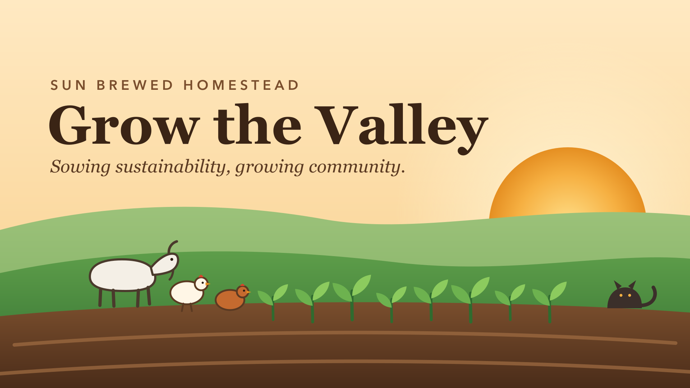

<p align="center"></p>

# Sun Brewed Homestead — operations core

*Sowing sustainability, growing community.* Licensed [AGPL-3.0-or-later](LICENSE).

One Rust service that records the farm's day-to-day operations (locations,
plantings, harvests, tasks, inventory), its programs (animals and Kiki's Cat
Club, gifts, events and volunteer hours, the farm stand, the mailing list)
and keeps outside systems in sync with them. It serves a web UI, a JSON API and Discord slash commands, and pushes
events to Discord and Linear.

```
 UI (/)  ─┐                                   ┌─► Discord webhook  (all events)
 API     ─┼─► store ──(same txn)──► events ──►│
 Discord ─┘   Postgres               outbox   └─► Linear           (opted-in tasks and
 /task                               dispatcher                     their completion,
                                                                    low-stock reorders)
```

## Crates

| crate | role |
|---|---|
| `domain` | Types, validation, and the event catalog. No I/O. |
| `store` | Postgres (sqlx) persistence and the transactional outbox. |
| `bus` | The `Sink` trait plus the dispatcher: routing, leasing, retry, dead-letter. |
| `integrations` | Discord (webhook sink, signed interactions) and Linear (GraphQL sink). |
| `server` | Axum + Maud: UI, `/api/v1`, `/discord/interactions`. Ships the `homestead` binary. |

## Configuration

**Everything is configured in [`homestead.toml`](homestead.toml) except
secrets.** That covers which integrations are on, which events each one
receives, retry timing, Discord's application id and public key, Linear's
team, Documenso's URL, and the path of every system's spec file. Secrets come
only from the environment, and the app refuses to start if an enabled
integration is missing one, listing every missing variable at once:

| Secret | Needed when |
|---|---|
| `DATABASE_URL` | always |
| `ADMIN_TOKEN` | optional: a legacy shared **API** credential (≥ 32 chars); it no longer signs anyone in to the UI |
| `DISCORD_WEBHOOK_URL` | `[discord] enabled` (written by `just discord-provision`) |
| `LINEAR_API_KEY` | `[linear] enabled` |
| `BUFFER_API_KEY` | `[buffer] enabled` |
| `DOCUMENSO_API_TOKEN`, `DOCUMENSO_WEBHOOK_SECRET` | `[documenso] enabled` |
| `RESEND_API_KEY` | `[grants] enabled` (outbound grant email) |
| `DISCORD_BOT_TOKEN`, `DISCORD_CLIENT_SECRET` | Discord feed/role grants and the signed `/join` OAuth continuation |
| `ZEFFY_API_KEY`, `GH_ORG_ADMIN_TOKEN` | CI provisioning/verification only |

`HOMESTEAD_CONFIG` points at a different file (e.g. a git-ignored
`homestead.local.toml` with `secure_cookies = false` for local http), and
`BIND_ADDR` overrides `[server].bind` for containers.

`ZEFFY_WEBHOOK_SECRET` enables the signed `/hooks/zeffy` receiver. It is
optional until the webhook is configured in Zeffy; when absent that route is
not exposed and returns 404.

## Running it

```sh
just db                 # Postgres 17 on localhost:54329 via Apple `container`
cp .env.example .env    # DATABASE_URL is enough locally
just user-add you@example.org "Your Name" steward   # prints a one-time setup link
just run                # open the link, set a password, you're signed in
just check              # fmt + clippy -D warnings + tests (tests need `just db`)
```

## People, roles and capabilities

Everyone signs in as themselves: an email and a password (Argon2id). A
steward adds people on **People** (`/people`), which shows a one-time setup
link to send them privately; the link sets their password and expires after
72 hours or one use. Lost password: a steward makes a new link (the old
password's sessions end when it is used). The very first steward comes from
the command line: `just user-add <email> <name> steward`, then
`just setup-link <email>` for resets. Ten wrong passwords in a row lock an
account for 15 minutes.

What someone can do is a set of **capabilities** (`animals.read`,
`gifts.write`, `incidents.read`, `systems.admin`, …). Roles only bundle
them, in one table in [`domain::auth`](crates/domain/src/auth.rs):

| Role | Gets |
|---|---|
| Steward | everything, including People, integrations and contact export |
| Board | reads nearly everything (books, gifts, contacts, incidents, audit, reports) and approves grant campaigns; changes nothing on the farm |
| Farm Lead | runs operations: tasks, garden, animals incl. medical, inventory, purchases, equipment, community, farm stand, releases; reads and follows up incidents |
| Crew | does and records the work: tasks, garden, animals incl. medical, stock movements, equipment, farm stand sales; can report incidents |
| Volunteer | sees tasks, garden, animals (not vet records) and stock; ticks tasks off; can report incidents |
| Service | API callers: farm operations and system health, never people, money or safety records |

Handlers never check role names. Each one takes a `Can<cap::…>` extractor
that refuses the request (403) unless the caller holds that capability, and
is the only way a handler gets a database handle, which writes as the
caller. `your account can't do that (it needs gifts.write)` is the whole
error. Navigation shows only what the viewer can open. `/me` shows your own
capabilities and recent actions.

Scripts and other systems use **service accounts**, each with its own API
tokens (made and revoked on People; shown once, stored as a SHA-256).
`ADMIN_TOKEN`, if set, still works as a bearer token for `/api/v1`, acting
as a built-in service account, so existing scripts keep working until they
get their own token.

Discord slash commands act as the Homestead account linked to the Discord
user (People → *Link Discord*, the user's numeric id). Members who aren't
linked get Volunteer capabilities, which is what `/tasks`, `/task` and
`/lowstock` always allowed, and appear in the audit log as
`discord:<username>`.

## How integration works

1. Every write (e.g. `create_task`) appends an event in the **same
   transaction**, so an event exists exactly when its change committed.
2. The dispatcher (in the server process) gets woken by `LISTEN/NOTIFY` or by
   a 5 s poll. It routes each event to the sinks that accept it, creating one
   delivery row per sink.
3. Each delivery is leased, run with a 30 s timeout, then settled. Transient
   failures back off exponentially (12 attempts over about 2.4 h). Permanent
   failures dead-letter right away. **Integrations → Retry** revives a dead
   letter.
4. Delivery is **at-least-once**. A sink can see the same event twice.
   Discord may show a duplicate message. Linear can't duplicate: each issue
   Homestead creates gets an id Homestead derives from what it mirrors (the
   task, or the item and event of a low-stock crossing; Linear accepts a
   client-chosen UUID). A delivery looks that id up before creating, so a
   crash after Linear accepted the issue but before Homestead recorded it
   is healed by the retry, which finds the issue and writes it back
   (`tasks.linear_issue_id`, `low_stock_issues`). Completing a mirrored
   task moves its issue to Done unless someone already closed it there.

### Adding an integration

Implement `homestead_bus::Sink` (`name`, `accepts`, `deliver`) and return
`Retryable`/`Permanent` errors honestly. Then register it in
`crates/server/src/main.rs`, behind its env vars. Test it against `wiremock`
the way `crates/integrations/tests/sinks.rs` does.

## Systems as code

Every outside system is described by a file in this repo, and GitHub Actions
(`systems.yml` in the deployment repository) keeps it true in both
directions:

| System | Spec | Pull request | Merge to `main` | Nightly |
|---|---|---|---|---|
| Discord | [`discord/server.toml`](discord/server.toml) | plan | pull, apply, re-check | pull, re-check |
| Linear | [`linear/workspace.toml`](linear/workspace.toml) | plan | pull, apply, re-check | pull, re-check |
| GitHub | [`github/org.toml`](github/org.toml) | plan | pull, apply, re-check | pull, re-check |
| Zeffy | [`zeffy/campaign.toml`](zeffy/campaign.toml) | verify | pull readable fields, verify | pull, verify |
| Buffer | [`buffer/account.toml`](buffer/account.toml) | verify | pull readable fields, verify | pull, verify |
| Documenso | [`documenso/releases.toml`](documenso/releases.toml) | verify | verify | verify |

Run any of them locally with `just discord-plan`, `just linear-plan` or
`just zeffy-verify` (credentials come from `.env`).

`just systems-sync` performs the inbound half explicitly. A value counts as
an edit made in an application only if it changed since CI last recorded
what that application reported (`refs/homestead/live`, a commit chain the
Systems workflow advances after every apply with `systems-sync --record`).
A value that merely differs from the repo is repo intent still waiting to be
applied (no admin token yet, or a setting only a person can change), and
the repo keeps it. A repo-only edit is left for provisioning; an
application-only edit is written back to TOML; independent edits on the two
sides are merged, including inside arrays of named objects. If both sides
changed the same value differently, the command stops and names the
conflicting TOML path. Before the first recorded baseline nothing is pulled.
Writes are atomic and preserve the comments in the human-maintained specs,
and every pull prints each changed field as `path: old → new`.

This differs deliberately from GitHub's
[Entitlements](https://github.com/github/entitlements-app), which is
one-way: the config repo is the only authority and live drift is reverted
on the next deploy. Entitlements' git-repo auditor records the state after
each deploy in a separate repo; `refs/homestead/live` plays that role here,
and is also what makes the inbound merge safe.

Only state each API can actually read is pulled. This includes managed
Discord server/role/channel/member values, Linear team/workflow/label/project
and listed-member values, GitHub organization/team/repository and listed-member
values, Zeffy's campaign status/goal/currency, and Buffer's organization
name. Unmanaged objects are not silently adopted, and
write-only values such as Discord webhook URLs, images, Linear project seed
documents, Buffer draft hashtags, and Documenso's repo-owned one-off release
templates remain repository-owned.

**Any setting.** Besides the fields each spec names, every system that
can be changed through an API takes a raw settings table, using the API's
own field names:

| System | Table | Takes any field of |
|---|---|---|
| Discord | `[server.settings]`, a channel's `settings` | Modify Guild, Modify Channel |
| Linear | `[team.settings]` | `TeamUpdateInput` |
| GitHub | `[org.settings]`, a `[[repos]]` entry's `settings` | Update an organization, Update a repository |
| Documenso | `[meta]`, a release's `meta` | envelope `meta` |

A field that names a channel (`afk_channel_id`) or workflow state
(`autoCloseStateId`) can be given by name. A misspelled field fails with
its name: Discord never converges on it, Linear and GitHub reject it, and
`documenso-verify` checks names against the instance's API description.

**Adding people.** Each system with an API for it takes a list of people
in its spec. Merging the change applies it:

| System | Where | Key | Value | Someone new |
|---|---|---|---|---|
| Discord | `discord/server.toml` `[members]` | username | roles | pending until they accept an invite |
| Linear | `linear/workspace.toml` `[members]` | email | `admin`, `member` or `guest` | invited to the workspace and team |
| GitHub | `github/org.toml` `[[members]]` and teams | login | `admin` or `member` | invited to the org |

Discord needs the bot's Server Members Intent (Developer Portal → Bot) to
list people. With it, anyone unlisted is reported with the roles they hold.

Nobody is removed automatically: people missing from a list are reported as
unmanaged. Buffer, Zeffy and Documenso have no API for adding people, so
their team members are managed in each web app.

**Zeffy is verify-only.** Zeffy's API can read campaigns but can't create or
edit them, so a person builds the form in the Zeffy dashboard, following
`zeffy/campaign.toml` section by section. CI then checks the title, goal and
currency, and **fails if the campaign goes live while the spec says
`status = "draft"`**. That's how "private for now" is enforced.

**Buffer is verify-only too.** Connecting Instagram or Facebook is a login
in Buffer's web app. Once connected, the core app saves a *draft idea* in
Buffer for each harvest and new planting, titled "📸 Needs photo", for a
person to finish and approve. It never publishes on its own.

Repository secrets and variables (Settings → Secrets and variables → Actions):
`DISCORD_BOT_TOKEN`, `LINEAR_API_KEY`, `ZEFFY_API_KEY`, `BUFFER_API_KEY` and
`GH_ORG_ADMIN_TOKEN` as secrets;
`DISCORD_GUILD_ID` and `DISCORD_APPLICATION_ID` as variables. A missing
Discord or GitHub-org token makes that job warn rather than fail.

## Legal releases (Documenso)

Every document the homestead has people sign is written in
[`legal/*.typ`](legal), listed in
[`documenso/releases.toml`](documenso/releases.toml), and rendered to PDF
with `./legal/build.sh`:

| Document | Who signs | The sender fills in | The signer fills in |
|---|---|---|---|
| **Welcome agreement**: how we work together, liability release, photo permission and mutual confidentiality, signed once | everyone joining (community, volunteers, crew) | | emergency contact and phone |
| Liability waiver | visitors, workshop participants, volunteers | | |
| Photo, video and voice release | the same | | |
| Mutual confidentiality agreement | board (crew sign it in the welcome agreement) | | |
| Volunteer agreement and code of conduct | volunteers | | emergency contact and phone |
| Cat adoption agreement | adopters | cat, microchip, fee | |
| Cat foster agreement | fosters | cat(s), start date | |
| Cat surrender agreement | people giving up a cat | cat | known health or behavior issues |
| Conflict of interest statement | board, every year | | role, interests |

The welcome agreement combines the standalone documents, signed once;
keep its terms in step when you change one of them. Both it and the
liability waiver open with an "In plain words" summary (the join page
shows the same words, checked by a test), and set the release apart in a
boxed section the signer initials: California courts refuse releases
buried in a longer agreement (Leon v. Family Fitness Center, 1998), and
`every_release_and_irrevocable_permission_is_boxed_and_initialled` fails
on any document that releases negligence or gives a permanent permission
without both. Photo permission is part of it: joining means agreeing to
photos, and anyone may withdraw that for future uses in writing (an
irrevocable version was tried and dropped as too off-putting). CI fails if a
committed PDF or layout doesn't match its source, and the build fails if
a document's signature doesn't land on its last page. The **Releases**
page sends
chosen releases to someone through Documenso. Documenso has no email set
up yet (`distributionMethod = "NONE"` in `releases.toml`), so each pending
release shows its signing link, to people who can send releases only, for
the sender to text or DM, or to open on a phone at the gate; the link is
cleared once it's signed or declined. When they sign or
decline, Documenso calls `/hooks/documenso`, the outcome is recorded, and
Discord gets "✍️ Jane Doe signed the Photo Release". Email addresses never
leave the database. The page offers **bundles** (joining, visitor, board,
adoption, foster, surrender) that tick the right documents.
They are defined in `releases.toml`. Details the sender fills in are locked
on the document, and nothing is sent if any selected document is missing
one.

- **Joining through Discord.** Newcomers see only 📌 Start here until
  they run `/onboard name email [joining_as]`. The bot replies (to them
  alone) with the welcome agreement's signing link; asking again while
  it's out gives the same link. When one sent for them is signed, the
  `member.onboarded` event goes through the outbox and the
  `discord-roles` sink gives them **Volunteer** or **Community** (the
  only roles anyone can give themselves; `OnboardingRole`). Someone who
  already signed gets a new role without signing again. Crew, working
  groups, the Board and Stewards stay in `discord/server.toml`
  `[members]`. The Releases page lists everyone who joined this way, and
  everyone in Discord who holds a role without a signed agreement (bar
  Stewards and the Board), so nobody slips through a hand-given role.
- **Approved, not attorney-reviewed.** They were written without a lawyer
  and approved for use by the steward on 2026-09-29 (`approved = true` in
  `documenso/releases.toml`). Setting `approved = false` stops all sending
  and puts a DRAFT watermark back on (run `./legal/build.sh`).
  `just documenso-verify` keeps reporting the missing review until a
  California attorney has read them and `reviewed_by_counsel = true` is
  set. Minors are handled by a parent signing on their behalf; ask counsel
  whether you want a separate minor-specific form.
- **Signing fields come from the layout.** `release.typ` draws every box
  at a fixed page position and tags it with its Documenso field type;
  `build.sh` writes those tags to `legal/<key>.fields.json`, and the core
  sends exactly those fields. The core refuses to start if a layout's
  detail boxes differ from the release's `details`, or its signature isn't
  on the last page.
- **Adding a document:** write `legal/<key>.typ` with
  `release.with(title:, intro:, details: (...))`, add a `[[releases]]` entry
  with the same detail labels, run `./legal/build.sh`, and add it to a
  bundle.
- **Self-hosting:** [`deploy/documenso`](deploy/documenso) has the compose
  file, env template and signing-certificate script. Telemetry is off.
  Documenso refuses webhooks to private addresses. If the core is reached
  privately, list its *hostname* (not an IP) in
  `NEXT_PRIVATE_WEBHOOK_SSRF_BYPASS_HOSTS`, because Documenso's web form
  rejects private IPs even when the server would allow them.

## Grant studio

The authenticated **Grants** page is a review-first mail merge for funder and
partner outreach:

1. Start with one of nine built-in letters, or write and save your own. Four
   are built on the homestead's sourced facts (501(c)(3) and EIN from the
   IRS; Kiki's Cat Club numbers, compost system and farm stand from the
   website): animal welfare, urban agriculture, composting education, and a
   sponsor thank-you that takes an `{{update}}` CSV column. Five are general
   (foundation introduction, community partnership, corporate sponsorship,
   in-kind request, follow-up). Saved templates can be
   edited and use one of four branded designs. Variables use `{{name}}`;
   built-ins are `contact_name`, `organization`, `program_name` and `email`.
2. Add recipients individually or paste CSV. The CSV requires `organization`,
   `email` and `source`; extra columns become custom template variables.
3. Generate a campaign. This freezes a personalized subject, plain-text copy
   and branded HTML copy for every active recipient. If any variable is
   missing, no campaign is created.
4. Review the exact copies and explicitly approve the campaign.
5. Send a bounded batch. The app never sends a draft, skips locally suppressed
   recipients, records failures for review, and uses each message UUID as the
   provider idempotency key so a retry does not intentionally duplicate mail.

Drafting and previewing work with `[grants] enabled = false`. To unlock sending,
verify the `from` domain with Resend, set `RESEND_API_KEY`, update the `from` and
`reply_to` addresses, and enable the integration. `max_batch` limits one button
press to 1–100 messages; the shipped value is 25. Recipient source is required
to preserve provenance, and **Suppress** prevents future delivery to that
address. Import only contacts for whom this outreach is lawful and relevant.

Every message ends with "Not the right fit? Reply "unsubscribe"…" and carries
a `List-Unsubscribe` header pointing at `reply_to`, so mail clients show an
Unsubscribe button. Suppress anyone who replies. Volume is bounded by Resend,
not the app: the free plan sends 100 emails a day (3,000 a month), and Pro
($20/month) sends 50,000 a month. Most foundations take applications through
their own portals, so the studio is for letters of inquiry, partnership asks
and sponsor stewardship; the full application still goes in by hand.

## Programs

Pages for the work the homestead actually does, each backed by its own
migration and tested against Postgres:

| Page | Records | Worth knowing |
|---|---|---|
| **Animals** (`/animals`) | the flock, goats, Kiki's Cat Club cats; care (vaccines, spay/neuter…); placements (foster, adoption, return to colony, transfer) | Cats and goats are one per record (a CHECK enforces it); a flock may be counted. A placement moves the status in the same transaction. An adoption posts "Mochi the cat was adopted!" to Discord: the animal's name only, never the adopter's. The Cat Club numbers count what's recorded here, not the website's tally since Aug 2024. |
| **Gifts** (`/gifts`) | sponsors, in-kind gifts, cash handed over in person | Zeffy receipts its own donations; these are ours. Any gift of $250+ is flagged until its IRS acknowledgment (Pub 1771) is marked sent. The printable letter states cash, or *describes* property without valuing it, and says what we gave in return. An in-kind gift with no estimate is treated as owing a letter. |
| **Community** (`/community`) | events (work days, potlucks, workshops, adoption events, talks) and volunteer shifts | Hours roll up per working group (the Discord roles and Linear labels of the same names) over our July–June fiscal year. |
| **Farm stand** (`/stand`) | sales and compost drop-offs | The price list is the website's. Selling eggs needs CDFA egg-handler registration, which also wants three years of sale records; no buyer names are stored. |
| **Mailing list** (`/contacts`) | people who asked to hear from us | An unsubscribe is permanent: imports merge interests but never re-add someone who opted out. CSV export neutralises cells that look like spreadsheet formulas. |

Nonprofit filing deadlines (the 990-N, FTB 199N and AG RRF-1 are all due
**Nov 15**, because the fiscal year ends June 30), registrations and
insurance are in [`docs/COMPLIANCE.md`](docs/COMPLIANCE.md). What to do when
wildlife turns up, and the LA County rehabbers to call, is in
[`docs/WILDLIFE.md`](docs/WILDLIFE.md).

## QR tags and public pages

Most people doing the work are in the Instagram group chat and never make
an account, so two kinds of page need none.

**QR tags** (`/tags` to print, `/t/{code}` when scanned). A tag goes on a
tool, a supply bin, a flock's coop, a place, or the gate. A phone's own
camera opens it; no app or in-browser scanner (Safari has no
`BarcodeDetector`). What the page offers depends on what it's stuck to:

| Tag on | Anyone holding it can |
|---|---|
| a tool | check it out, return it, report a problem (marks it needing repair, files a fix-it task) |
| a supply | record "used 2 bags" on the ledger (from the place holding the stock) |
| a flock | log eggs collected; two collections in a day add up |
| a compost pile | log a drop-off |
| any place or animal | report something wrong (a task to look into it) |
| the gate | sign in and out; the visit becomes a volunteer shift, and open visits are Community's "on site now" |

The code is the credential, like a setup link: ten characters from an
alphabet without look-alikes (about 49 bits), sent with `no-referrer` and
`noindex`. Each action is one small, bounded write attributed to the
signed-in person if their cookie came along, otherwise to
`"<typed name> (tag <code>)"`. A lost or misused tag is retired on `/tags`,
and a new one printed. Making, printing and retiring a tag needs the right
to change what it's on (`TagKind::manage_cap`).

**Planning an event** (`/community/events/{id}`). Each event's page holds
its plan: who can come, the tasks to finish, and the stock and equipment
that must be ready. A volunteer has one RSVP per event (attending, maybe,
unavailable, with a note) and the latest answer replaces the earlier one.
Tasks, stock lines and equipment are links to the ordinary records, so
unlinking never deletes the task or the tiller, and deleting an event takes
only its plan. Stock shows the planned quantity beside what's on hand (it
warns, it never reserves or refuses), and equipment that isn't in service
is flagged. Cancelling marks the event `cancelled` and leaves its plan
intact; editing and cancelling need `community.write`, reading the plan
needs `community.read`.

**Volunteers** (`/community/volunteers`). Shifts and gate visits each
name a volunteer record: a name, optional email and phone, and whether
they're still volunteering. Nothing more; this isn't HR software.

- **A typed name finds its person.** The gate and the hours form take a
  name; `volunteer_names` maps every name a volunteer goes by
  (case and surrounding spaces ignored) to them, and an unknown name
  makes a new volunteer. Turning up again marks someone active.
- **Merge, don't guess.** "Sam" and "Sam R." stay two people until
  someone who manages volunteers (`community.write`) merges one into the
  other: shifts, visits and the name move over, so the next "Sam" at the
  gate is Sam R. Renaming keeps the old name working too. A name means one
  person at a time, so two different Sams need two different names.
- **Contact details** show only to `community.write`, as in the audit log.
  Crew see names and hours.
- A shift keeps `person_name` as it was typed that day, for the record.
  The migration made one volunteer per distinct name already stored.

**Adoption** (`/adopt`). Lists adoptable animals by name, species, sex, age
and a blurb written for the page (never notes or vet records) and takes
applications. There's a honeypot field, and a double-submit counts as one
application. Leads read applications at `/applications` (`animals.write`). A new
application emits `adoption.applied`, naming the animal only.

Also on the stand: **egg carton labels** with what CDFA requires
(`/stand/egg-labels`), and a **stand sign** with egg size and grade next to
the price, plus a QR code for each `[stand] pay_links` entry
(`/stand/sign`). Animals are **looked up by microchip** (`/animals/chip`,
fed by any keyboard-mode reader). Adopting a chipped animal files a task
to transfer the registration.

## Brand

[`brand/`](brand) holds the sun-and-sprout mark (`mark.svg`) and the "Grow the
Valley" banner, drawn as SVG and rendered with `rsvg-convert`. The mark is the
Discord server icon and bot avatar. The text-free banner is the Zeffy
campaign banner (16:9).

## Discord server

The team's Discord server is defined as code in
[`discord/server.toml`](discord/server.toml): its roles, who holds them, who
can see and post where, channel topics, the welcome and rules posts, and the
webhook the core posts to. `just discord-plan` shows the differences between the file and the
live server. `just discord-provision` applies them. It is safe to re-run, and
it never deletes anything the file doesn't mention; those items are listed as
"unmanaged".

| Role | Sees | Posts |
|---|---|---|
| *(no role yet)* | Start here | nothing |
| Community | + Community, Farmhouse voice | Community |
| Volunteer | + Volunteers | Volunteers (except the guide) |
| Crew | + Farm ops, Homestead core, Crew Huddle | Farm ops, #ops-bot |
| Board | Community, Farm ops, Homestead core, Leadership | Leadership (ops are read-only) |
| Farm Lead | everything | everywhere except #farm-feed |
| Steward | everything (Administrator) | everywhere |

To give someone a role, add their Discord username under `[members]`:

```toml
[members]
kiki = ["Crew", "Volunteer"]
```

Anyone listed ends up with exactly those roles (and loses any other role
defined in the file). Someone who hasn't joined yet is listed as pending and
gets their roles on the first run after they accept an invite. A bot can't
add people to a server.

A few Discord behaviours shape how this works:

- **Bots can't create servers.** Discord removed that on 2025-07-15. A person
  creates the empty server; the provisioner does the rest.
- **The bot needs Administrator.** A bot can only grant permissions it holds,
  and Steward is an Administrator role.
- **Managed channels' permission overwrites are fully owned.** Hand-added
  per-member overrides on those channels get reset on the next apply.

## Task assignees

A task is either someone's or anyone's. **Tasks** has *Take it* on an
unassigned task, *Let go* on yours, and *Change* to give it to someone
else; the add form takes a *Who*. Filters show everyone's work, yours, or
what is still up for grabs. Today lists yours first, under **Yours**, and
names who has the rest. API clients use
`POST /api/v1/tasks/{id}/assign` with `{"assigned_to": "<person uuid>"}`
or `null` to put it back up for grabs.

- **People only.** A task can be given to an active human account, never
  a service account or someone disabled; a trigger refuses it. Disabling
  someone releases their open tasks so current work cannot wait on an
  account that can no longer act. A closed task keeps who did it.
- **Not Linear's assignee.** Linear's assignee stays on `linear_issues`
  as the text Linear reports; deadline reminders name the Homestead
  assignee and fall back to Linear's.

## Routines (recurring tasks)

A routine makes ordinary tasks on a schedule: every N days (1 = daily),
on chosen weekdays, or monthly on a date (the 31st falls on the last day
of shorter months), optionally some days early. Add and pause them at the
bottom of **Tasks**; generated tasks show 🔁 and behave like any other
(listed, completed, announced on completion).

- **Exactly once per occurrence.** Each generated task carries its
  template and occurrence date, and a unique index on the pair makes a
  duplicate impossible, however many times or places generation runs.
- **No timer to lose.** The container sleeps when idle, so generation is
  driven by a cursor per routine, not a clock: it runs at start-up, hourly
  while awake, whenever Today or Tasks is opened, and on
  `POST /api/v1/recurring/run` for an outside cron. A woken container
  catches up on its first request.
- **Missed occurrences:** by default only the latest is made (a week of
  stale "check the water" tasks helps nobody; today's does). Tick *every
  occurrence matters* (medication) to get each one. Resuming a paused
  routine skips what was missed while paused.
- Tasks are made by `scheduler` in the audit log; whoever created the
  routine is recorded against the routine.

"Today" is the farm's date in `[server] timezone` (America/Los_Angeles),
computed by Postgres, for due dates, form defaults and the fiscal year; a
test forbids calendar dates taken from UTC in the server.

## Deadline reminders

Open tasks with a due date get a reminder in Discord two weeks out, in the
last week, the day before, on the day, and once when overdue. Each post
lists everything that reached a new stage that day, soonest first, with
its Linear issue and assignee.

- **Where:** tasks in a Linear project listed under `[discord]
  deadline_channels` go to that channel, posted by the bot (Grant writing →
  #grant-deadlines). Everything else goes to #farm-feed. A deadline channel
  must be one the Community role can't read, since reminders name internal
  tasks; the server refuses to start otherwise.
- **Once per stage.** `deadline_reminders` records each task, due date and
  stage, so a rerun posts nothing twice. Moving a due date starts over.
  A core that slept through a stage posts only the stage it wakes up in.
- **Routine tasks are left out.** They come due every day by design, and
  Today already shows them.
- **When:** on start and hourly while awake, after pulling Linear so due
  dates are current. On Cloudflare a daily cron (15:00 UTC) wakes the core
  for it; pages don't run reminders, because the pull can take seconds.

## Morning digest

Once each farm morning, one post to #farm-feed: counts first ("2 overdue ·
1 due today · 1 high priority · 1 low on stock"), then the tasks in each
group with who has them ("anyone" when nobody), then what's low. Each
section shows eight lines and counts the rest.

- **What's in it:** open tasks overdue, due today, and urgent or high
  ones not already listed; items at or below a reorder level that's set.
  Irrigation problems and equipment service are tasks already, so they
  appear once. Incidents and animal care are left out: #farm-feed is
  readable by Crew, who can't read incidents.
- **When:** the first scheduler run between 7:00 and noon farm time
  (`homestead_domain::digest::HOURS`). The Cloudflare cron at 15:00 UTC is
  7 or 8 a.m. in Los Angeles. A core asleep all morning skips the day
  rather than posting a morning summary in the evening.
- **Once a day.** `daily_digests` claims the date in the same transaction
  as the event, so two runs post one digest. A quiet day is claimed too
  and posts nothing, even if something goes overdue later.
- Remove `digest.daily` from `[discord] events` to turn it off; people can
  also have it pinged to them on their notification settings.

## Farm operations

Places nest (a row in a bed in a garden) and can be edited or retired without losing history. **Map** (`/map`) draws every place in use that has a shape (a point, a line, or an outline) on the farm's plan, each a link to its page, with what's growing, the next expected harvest, the last watering and open tasks and health issues, counting what's inside it. Coordinates are feet east and north of one fixed corner of the farm, not latitude and longitude: phone GPS is good to a few metres, too coarse to tell one 4 ft bed from the next, and a tape measure isn't. A rectangle is two opposite corners; an outline that crosses itself is refused, since its area would be wrong. The map is server-drawn SVG, so it works with JavaScript off; with it on, tapping the plan while the editor is open adds points. **Readings** (`/readings`) take any number off a place, a planting, an animal or a piece of equipment without a new table or page per measurement: a kind typed as free text ("compost temperature", stored lower-case so it groups) and one or more named values, each with the unit it was taken in (`temperature = 142 °F`, `moisture = 55 %`). Units are never converted, so a trend (latest, range, and its shape over the last 30 readings) only ever compares one quantity in one unit at one thing. A reading measures exactly one thing (a CHECK enforces it), shows to whoever may read that thing, and needs the right to record its work (garden, animals or equipment). A place's page shows the readings of everything inside it. The typed records (harvests, soil tests, egg days, watering) stay the way to record what they cover. **Movement history**: an animal's home and a piece of equipment's location are "where it is now"; every change to either, from any form or the API, writes a movement in the same statement (a database trigger), so the history can't miss one. Each animal and machine page lists where it's been as stays ("Pasture A, from 2026-08-01, 14 days") with a Move form that takes an optional earlier time and a note; a move dated before the last one recorded is refused, since "where it is now" would then disagree with the history. A place's page lists what moved in and out of it. History starts from the migration: things already somewhere are recorded as being there then, not since whenever they arrived. A flock or herd is one record, so moving it moves everyone in it; there are no separate group memberships. A place page covers the place and everything inside it: what is growing, what is planned (each plan with when its crop or family was last there), what grew before with its sowing and end dates, harvests, watering and tasks. Finishing or failing a planting records its end date; bringing it back clears it. A rotation check answers "when was this crop, or its family, last here?" as information only: nothing refuses a planting, and a finished planting whose end wasn't recorded is reported as "at least N days", counted from sowing. **Crops** (`/crops`) plans a crop with its timing (days to transplant, days to first harvest, harvest window), seed lot and expected yield per sowing, sown in successions ("every 14 days, 4 times"). Each succession is a planned planting with a sowing task (and a transplanting task for transplants) in the ordinary task list. Ticking a sowing puts the planting in the ground that day and moves its transplant and harvest dates by as many days as it was early or late; ticking a transplant records the day. The page lists what to sow this week or is overdue, transplants due, and harvests expected within two weeks or overdue; each plan shows expected against harvested yield, compared only in the expected unit (other units are listed beside it, never converted). A planned planting is not announced (`planting.created` fires when it goes in the ground, so Buffer never drafts "just planted" for a plan), and plan tasks are not posted to Discord one by one. Each harvest has a page tracing it back (seed lot and its vendor, crop plan, planting, place) and forward: it is split into sale, donation, community use, feed, seed, loss and compost in the harvest's own unit, never more than was picked (the database locks the harvest while checking, so two people splitting at once can't overshoot), with the sold / donated / used here / lost shares and what's still unrecorded. A donated part is itself the produce donation, with its recipient and an optional operational value estimate (never a tax value). A farm-stand sale can name the harvest it came from, which records that harvest's sale part in the same step; a unit the harvest wasn't measured in (a bag from pounds) is refused rather than converted. Count harvest outflow from dispositions and the till from stand sales; never add the two. **Donations** (`/donations`) lists produce given in a date range (this fiscal year by default) with totals per unit and a CSV export; a seed lot's page lists the harvests it produced. A place's page shows its soil history, newest first and including what's inside it: tests keep each value as the lab wrote it (only pH is a number, 0–14) plus any other named measurements, and each test has a page for the lab's report; amendments (compost, fertilizer, lime, sulfur, mulch, other) record material, amount and unit together, reason and cost. **Crop health** (`/health`) records pest, disease and other observations against a planting or a place (a planting fills in its place), with severity, how much was affected, what was done, photos, and an optional follow-up date that makes an ordinary task (high priority for high severity). Closing an observation needs an outcome and ticks its follow-up task; the page filters by place, crop and open, and tallies the last year's trouble by crop. Nothing here diagnoses. Irrigation zones, egg days, compost batches, checklists, losses, compliance obligations, emergency procedures, and a program link on a purchase are recorded the same way. Their fiscal-year totals are on the **Report** (see below).

## Seed provenance

Seed lots record where seed came from (supplier and their lot number, or a
vendor we buy from; when; packed-for year; organic), optionally how much,
and photos of the packet. A planting can name its lot and how much of it
went in, so the Garden and lot pages answer: which lot produced this bed
(🌱 link), which plantings used a lot, where it came from, when, and what's
left (derived from the plantings, never stored separately). Sowing more
than a counted lot has left is refused. The same supplier lot can't be
recorded twice. API: `/api/v1/seed-lots`.

## Weather and water

**Water** (`/water`, `garden.read`/`garden.write`) logs watering (a
planting or a place, start, minutes, gallons if measured, method) and
weather readings (°F, inches of rain, mph, humidity, conditions). Forms take
local times and US units; storage is SI and UTC instants, converted by
Postgres in the farm's time zone, so a 7 am watering stays 7 am across DST.
The page shows rain since 1 October per source and water per bed over 30
days, counting runs whose amount wasn't measured rather than guessing.

Every record has a `source`: `manual` for people, `kind:id` (e.g.
`station:backyard`, `controller:zone3`) for machines, via
`POST /api/v1/weather` and `/api/v1/irrigation`. A station re-sending the
same instant, or a controller re-sending a run id (`external_id`), gets the
first record back unchanged, and machine records never replace manual ones;
rain totals stay per source so a gauge and a station aren't added together.
No MQTT or sensors are wired up yet.

## Inventory and purchasing

Stock is a ledger. Every change is an append-only row in `stock_movements`
with a kind (received, used, harvested/made, wasted, count correction,
moved out/in), an optional place, and who recorded it (from the audit log).
What's on hand, per place and in total, is maintained **by the database**
from those rows in the same transaction (`apply_stock_movement`), and
triggers refuse any other change to those numbers, or any edit or delete of
a movement: a mistake is fixed with a correcting movement. No place's stock
can go below zero. Moving stock between places writes a paired
`transfer_out`/`transfer_in`. Using stock without saying where takes it from
the only place that has any, and asks when there are several.

Purchases record vendor, date, the total paid and a category, with lines
for what was on the receipt (tracked items or plain descriptions such as a
delivery fee) and the receipt itself as an attachment. Receiving a line
writes one `receipt` movement tied to it; receiving it again changes
nothing, and a unique index makes a second receipt for the same line
impossible. An item's page answers "how much, where, what happened to it,
who, and which purchases it came from". Low-stock alerts still fire once per
downward crossing of the reorder level, whichever kind of movement caused it.

## Equipment

**Equipment** (`equipment.read`/`equipment.write`) records each tool or
machine: category, make and model, serial number (unique per maker), when
and for how much it was bought (cost shown only to `purchases.read`), where
it's kept, its condition and status (in service, needs repair, out of
service, retired). Its page holds manuals and photos, and a service history
(date, work, who or which vendor, cost, receipts, next service date).

"Next service" is read from the latest service record, not stored twice.
Recording a service with a next date can add an ordinary task due that day
("Service Tiller"), so it shows up in Tasks like any other. Checkout and
return aren't built: five people share the tools and nothing so far shows a
need to track who has what.

## Incidents

**Incidents** records injuries, near misses, animal bites and scratches,
property damage, food-safety problems and hazards: when and where, what
happened, what was done right away, who was involved, witnesses, and for
injuries and bites only how far treatment went (none, first aid, medical
care). It is deliberately not a medical record: no diagnoses or injury
details, and the form says so.

- **Anyone can report** (`incidents.report`, every human role). Reporters
  see only their own reports, can add photos while a report is open, and
  can't remove them.
- **Reading and follow-up are oversight-only**: `incidents.read` (Steward,
  Board, Farm Lead) sees all reports; `incidents.write` (Steward, Farm Lead)
  records the corrective action and a follow-up date and closes it. A report
  can't be closed without a corrective action; open ones past their
  follow-up date are flagged.
- Someone else's report answers 404, as does its photo. Services never see
  incidents, and incident rows in the audit log need `incidents.read`.
- The `incident.reported` event carries only the kind and a reference like
  `INC-3F9A21`, never names, places or descriptions. It isn't sent to
  Discord in the shipped config.

## Search

The box under the navigation (`/search`, and `GET /api/v1/search?q=` for
services) finds animals, tasks, inventory items, plantings, seed lots,
places, contacts, gifts, community events, equipment, vendors and purchases
by the start of any word: `moch` finds Mochi, `ana@exa` finds a contact,
and every word typed must match. Names rank above details and notes.

- **Nothing is found that you couldn't open.** Each kind of record is
  searched only if you hold its read capability (`SearchKind::read_cap`,
  the same one its page needs), so a volunteer searching a donor's name
  gets nothing. With no readable kind at all, search answers 403.
  Incidents are never searchable.
- It's PostgreSQL full-text search: a generated `tsvector` per table with a
  GIN index (`0019_search.sql`), using the `simple` configuration so names
  aren't stemmed. `every_search_can_use_its_index` checks each query can use
  its index. Input is reduced to letters, digits and `@ . _ -` before it
  becomes a prefix query, so it can't be read as query syntax.
- At most eight results per kind.

## Report

**Report** (`/report`, `/report.csv`, `GET /api/v1/report?year=2026`) sums a
fiscal year (1 July–30 June; `year` is the calendar year it starts in) up to
today while it's running. Every figure is a query over the dated day-to-day
records each time it's opened; there are no stored totals to drift.

| Section | Needs | Figures |
|---|---|---|
| Volunteers | `community.read` | hours, shifts, people (distinct names), hours by working group |
| Community events | `community.read` | events held by kind, attendance, events with no attendance recorded |
| Animals | `animals.read` | head counts assisted, arrived and placed (adoption, foster…) by species or kind; eggs |
| Harvest | `garden.read` | harvested by crop and unit, where it went, produce donated, losses |
| Farm stand | `stand.read` | revenue, sales, quantity by item and unit, compost drop-offs |
| Gifts | `gifts.read` | cash/check and sponsorship totals, in-kind count and donor estimates |
| Inventory | `inventory.read` | used, wasted, received, added from harvest, net corrections, by item and unit |
| Spending | `purchases.read` | purchases by linked program, else category |
| Incidents | `incidents.read` | reported by kind, still open |

- `reports.read` opens the page, and **each section also needs the
  capability to read the records it sums**. A total over one gift *is* that
  gift, so a Farm Lead (who holds `reports.read` but not `gifts.read`) gets
  no gift section, and the page says which sections were left out.
- Quantities are grouped by unit and never added across units.
- Things to know when quoting it: gifts are the ones recorded in
  Homestead; **Zeffy donations are totalled in Zeffy and not included**.
  "Animals assisted" counts animals that arrived, were placed, or are still
  in care having arrived by the period's end. It's a lower bound: an animal
  that died with no other dated record that year isn't counted. Volunteers
  are counted as volunteer records (see Volunteers), so "Sam" and "Sam R."
  are two people until someone merges them.
  Stock movements and incidents are timestamps, and fall on the farm's
  calendar day (`[server].timezone`), not UTC's.
- The CSV has one `section, metric, key, unit, value` row per figure. Keys
  and units people typed (crops, items, programs) are neutralised against
  spreadsheet formulas the same way as the contacts export; values stay
  plain numbers, so a negative correction is still a number.

## Attachments

Any record that needs files uses the same mechanism: animal photos, vet
records (on a care entry), gift receipts and grant documents today;
purchases, equipment and incidents as those pages land. PostgreSQL keeps
the metadata (`attachments`: owner, original name, media type, size,
SHA-256, who uploaded it, when, and the storage key); the bytes live in
private object storage, configured under `[attachments]`:

| backend | for |
|---|---|
| `disabled` | the shipped default: uploads are refused with an explanation |
| `filesystem` | local development (a Cloudflare container's disk is wiped on restart) |
| `s3` | a private Cloudflare R2 bucket (or any S3 API), secrets `ATTACHMENTS_ACCESS_KEY_ID` / `ATTACHMENTS_SECRET_ACCESS_KEY` |

- **Uploads go through the app** (the UI has no JavaScript). It reads at
  most `max_bytes` (10 MiB), decides the type from the file's own bytes
  (JPEG, PNG, GIF, WebP, HEIC or PDF; never SVG, HTML or office files, and
  never the browser's claim), hashes it, and stores it under a random
  256-bit key. S3 uploads are signed over that SHA-256, so storage rejects
  bytes that changed on the way.
- **An attachment is exactly as private as its record.** Seeing a vet
  record needs `animals.medical`, a gift receipt `gifts.read`. A file you
  may not read answers 404, the same as one that doesn't exist.
- **Downloads** are checked first, then redirected to a presigned link that
  works for `link_secs` (5 minutes); the bucket itself is never public.
  Images open inline, PDFs download; stored files carry their type and
  disposition, and locally served ones add `nosniff` and a sandbox CSP.
- **Removing a file is undoable for `retain_deleted_days` (30).** The row
  moves to `attachment_purges` with a snapshot, and
  `homestead attachment-restore <id>` puts it back. After that the hourly
  schedule deletes the bytes. The audit log keeps the name, size and
  SHA-256 either way.

### Production storage (R2)

R2 has **no object versioning** (`PutBucketVersioning` is unimplemented;
checked against Cloudflare's S3 compatibility table, 2026-09-28). Keys are
never reused or overwritten, so the only way to lose bytes is a delete.
Retention and recovery are built from what R2 does offer:

| bucket | lock (`att/`) | written by | holds |
|---|---|---|---|
| `homestead-attachments` | 30 days | the app (token: Object Read & Write, this bucket only) | live files, and deleted ones until purged |
| `homestead-attachments-backup` | 90 days | the deployment repository's `backup.yml` only | a verified copy of every file, kept 90+ days after purge |

- A **bucket lock** refuses deleting or overwriting an object younger than
  its age, whoever asks: a stolen app key can't destroy the last month of
  uploads, and nobody can empty the backup of anything under 90 days old.
  Only an account admin can change a rule. `just r2-setup` creates both
  buckets and sets the rules (idempotent).
- The **nightly backup** (`homestead attachments-backup --prune`) copies
  every key the database accounts for that the backup lacks, checking the
  bytes against the recorded SHA-256 first. It fails the workflow on any
  file that is lost, corrupt, or only in the backup. Sundays add
  `--verify` (read back both copies). `--restore` refills the primary
  bucket from the backup. Pruning copies of purged files refuses to remove
  more than a tenth of the backup in one run, because an empty or wrongly
  restored database looks exactly like "everything was deleted".
- The backup's credentials live only in GitHub Actions secrets
  (`just backup-secrets`), never in the app. Both buckets are in one
  Cloudflare account, so losing the account loses both; an off-account
  copy is the remaining gap.

Turning it on: create three R2 API tokens (dashboard → R2 → Manage API
tokens): app (Object Read & Write, `homestead-attachments`), backup reader
(Object Read, `homestead-attachments`), backup writer (Object Read & Write,
`homestead-attachments-backup`). Put them in `.env` as
`ATTACHMENTS_{ACCESS_KEY_ID,SECRET_ACCESS_KEY}`,
`ATTACHMENTS_READ_{…}` and `ATTACHMENTS_BACKUP_{…}`, run
`just cloudflare-secrets` and `just backup-secrets`, and only then set
`backend = "s3"` (the core refuses to start without its keys).
`crates/integrations/tests/s3_live.rs` is an opt-in round trip against a
real bucket.

## Security model

- **Tables live in the `homestead` schema, not `public`.** Supabase's Data API
  exposes `public` to anyone with the publishable key, and new tables there are
  granted to `anon` by default. A test fails if a table lands in `public`.
- **Per-person sessions.** The session cookie holds 256 random bits and is
  `HttpOnly; SameSite=Strict; Secure`, which is also the CSRF defence for
  form posts. The database stores only its SHA-256 (as for setup links and
  API tokens), so a leaked backup can't be replayed as a sign-in. Sessions
  last 30 days; signing out, disabling someone, or setting a new password
  ends them server-side. Unknown emails are checked against a dummy hash so
  timing doesn't reveal who has an account.
- **Capabilities, checked in one place** (see *People, roles and
  capabilities*). A test reads every `.route(…)` in the server's source and
  requests it as a signed-in caller holding no capability: anything but 403
  fails it, so a new route can't ship unguarded.
- **API writes are idempotent.** Every non-read request below `/api/v1`
  requires an `Idempotency-Key` (1–200 characters). Repeating an identical
  request returns the stored status/body with `Idempotency-Replayed: true`;
  reusing a key for different input is rejected.
- **Audit history is append-only and names who did it.** Database triggers
  record before/after images for operational records, stamped with the
  actor's id and name from transaction-local settings (`homestead.actor`,
  `homestead.actor_id`) that every store write sets; a source-scanning test
  (`writes_are_attributed`) fails any write that bypasses them. Sign-ins,
  failed sign-ins, sign-outs, setup links and password changes are audit
  entries too; password hashes live in a table that is never row-audited.
  `/audit` (`audit.read`) and `/api/v1/audit` show the history, filtered
  like everything else: an entry holds the whole row, so it's visible only
  to someone who could read that row (`AUDIT_VISIBILITY` in
  `domain::auth`; attachments by their owner). A test reads the live
  trigger catalogue and fails for any audited table without a rule.
- **API idempotency keys are per caller.** Two services choosing the same
  `Idempotency-Key` never replay each other's stored responses.
- **Public pages are few and deliberate**: sign-in, webhooks, the PWA
  shell, `/adopt` and QR tags (`/t/…`). The RBAC sweep lists them by name
  in `OPEN`; any other route answering a capability-less caller fails it.
  Their handlers use `AppState::tag_store` / `public_store`, never the
  system store directly.
- **Pages show only what the viewer can use.** A second sweep opens every
  page as each role, submits every form on it and follows every in-app
  link: any 403 fails it.
- **Discord interactions** are Ed25519-verified before any parsing. Requests
  older than 5 minutes are rejected as replays.
- **Outbound Discord messages disable mention parsing**, so a task titled
  `@everyone` pings no one.

## Behaviours worth knowing

- **Low-stock alerts fire once per downward crossing** of the reorder level,
  not on every movement below it. An item created empty doesn't alert until
  it has been stocked above its level and then drawn down again.
- Completing an already-completed task is a no-op and announces nothing.
- Harvest totals are grouped per unit and never summed across units.
- Dates are ISO-8601 strings everywhere (API and event payloads).

## Operations, metrics and recovery

The accountability migration includes seed/lot provenance, vendors and
purchases, recurring-task templates, weather and irrigation observations, and
attachment metadata with SHA-256 integrity. Attachment bytes live in private
object storage (see [Attachments](#attachments)), backed up nightly to a
second, locked bucket.

Authenticated Prometheus metrics are at `/api/v1/metrics` (bearer token). They
cover outbox state, audit and idempotency records, Zeffy deliveries, and age of
the latest verified restore. Structured request logs continue through
`tracing`; set `RUST_LOG` to control detail.

`just backup` creates a checksummed custom-format database dump. `just
restore-test <dump>` restores it into a disposable PostgreSQL 17 instance,
checks the restored schema and key ledgers, and records the successful drill.
The response procedure, RPO/RTO, retention, attachment recovery, validation
and cutover checklist are in [`docs/DISASTER-RECOVERY.md`](docs/DISASTER-RECOVERY.md).

## Zeffy webhooks

Configure Zeffy to send events to `https://<core>/hooks/zeffy` and set the
dashboard signing secret as `ZEFFY_WEBHOOK_SECRET`. The receiver verifies the
`Zeffy-Signature` HMAC against the raw body, rejects timestamps outside five
minutes, accepts payment lifecycle events, and deduplicates Zeffy's stable
event ID. Reconciliation after downtime is described in the recovery runbook.

## Hosting

The core runs on **Cloudflare Containers**, at
<https://homestead.example.org>: one small container
that sleeps when idle, so it costs cents a month on top of the Workers Paid
plan. [`deploy/cloudflare`](deploy/cloudflare) has the config, the deploy
steps and the cost arithmetic, including why it is *not* kept always-on.

Its database is Supabase. Set `DATABASE_URL` to the **session pooler**
(port 5432, IPv4). The direct `db.<ref>.supabase.co` host is IPv6-only, and
the transaction pooler (6543) breaks prepared statements and `LISTEN`. The
server runs migrations on startup.

Legal releases are signed on **Documenso**, hosted the same way at
<https://sign.example.org>
([`deploy/documenso/cloudflare`](deploy/documenso/cloudflare)): one `basic`
container, asleep when idle, with its own `documenso` database on the same
Supabase server. It can't send email yet (see its README), so until then
copy signing links to people yourself.

**Deploy on push (Workers Builds).** Connect the repo in each Worker's
Settings → Builds, production branch `main`, preview builds off
(`versions upload` never updates a container):

| Worker | Root directory | Build command | Deploy command | Watch paths |
|---|---|---|---|---|
| `homestead-core` | *(repo root, where the Dockerfile is)* | `npm ci --prefix deploy/cloudflare` | `cd deploy/cloudflare && npx wrangler deploy` | exclude `*.md`, `deploy/documenso/*` |
| `homestead-sign` | `deploy/documenso/cloudflare` | `npm ci` | `npx wrangler deploy` | include `deploy/documenso/cloudflare/*` |

Workers Builds deploys every push to `main`, whether or not GitHub CI
passed. The Systems workflow first reconciles live, readable integration
state; if it finds application-only edits, it commits those TOML changes and
the resulting push becomes the fully synchronized deployment revision.
A same-field conflict fails the Systems workflow rather than choosing a
winner. A system whose credential is missing is skipped with a warning, as
its provisioning job is. Secrets live in each Worker and survive deploys; change them with
`just cloudflare-secrets` / `just documenso-cloudflare-secrets`, and a
running container restarts itself on its next request.

The repo is mirrored to `cameronaaron/homestead` by
`mirror.yml` (deployment repository) on every push to `main` and
daily.

## Not built yet

These are deliberately out of this first cut:

- Linear → Homestead: a restock doesn't close its reorder issue (closing a
  linked issue in Linear does complete its task; see `store::linear`)
- Photos taken while logging becoming Buffer drafts, and adoptable
  animals' photos on `/adopt` (attachments are private, presigned links
  that expire, so a public page can't show them as they are)
- Listing adoptable cats on RescueGroups.org (free; it syndicates to
  Adopt-a-Pet and Petfinder and has a write API), which needs the Cat
  Club's own account first
- Zeffy donation accounting workflows beyond durable, verified webhook
  ingestion and recovery reconciliation
- Buffer and Instagram posting (e.g. harvest photos to social)
- Sensors over MQTT (Mosquitto is installed on the dev machine), such as
  soil moisture or coop temperature feeding `observations`
- An API (and Discord commands) for the program pages; they are UI-only
- Importing Kiki's Cat Club history from before the app
